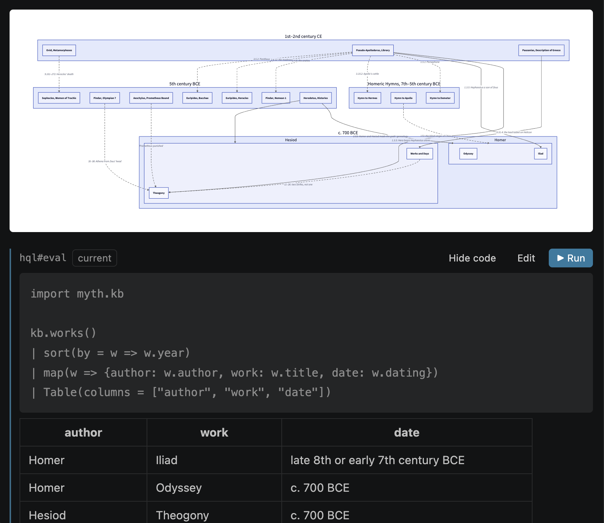

<section class="hmd-band hmd-band--hero" markdown>
<div class="hmd-hero-grid" markdown>
<div class="hmd-hero-text" markdown>

# HyperMarkDown { .hmd-hero }

<p class="hmd-tagline">An AI-ready document language for humans and machines.</p>

Built on the simplicity of Markdown, HyperMarkDown brings together wiki links,
structured metadata, rich visuals, semantic relationships, and executable HQL
cells. Write documents, connect ideas, build a mesh of knowledge, and bring it
to life through computation and AI.

<p class="hmd-actions" markdown>[Quick start](tools/index.md){ .md-button .md-button--primary } [Tutorial](wiki/hmd-tutorial.hmd){ .md-button }</p>

```sh
# VS Code: preview, graph, cells
code --install-extension hypermarkdown.hmd
# hmd: the linter and site builder
pip install HyperMarkDown
```

<p class="hmd-fineprint hmd-fineprint--hero" markdown>The tools implement specification 0.1, a draft.</p>

</div>
<div class="hmd-term" markdown>
<div class="hmd-tabbar" role="radiogroup" aria-label="Examples">
<input type="radio" name="hmd-demo" id="hmd-demo-link" value="link" checked><label for="hmd-demo-link">Link</label>
<input type="radio" name="hmd-demo" id="hmd-demo-embed" value="embed"><label for="hmd-demo-embed">Embed</label>
<input type="radio" name="hmd-demo" id="hmd-demo-diagram" value="diagram"><label for="hmd-demo-diagram">Diagram</label>
<input type="radio" name="hmd-demo" id="hmd-demo-cell" value="cell"><label for="hmd-demo-cell">Cell</label>
<input type="radio" name="hmd-demo" id="hmd-demo-check" value="check"><label for="hmd-demo-check">Check</label>
</div>
<div class="hmd-pane" data-tab="link" markdown>

```hmd title="specs/auth/index.hmd"
- [[login]]
- [[logging]] — the **auth** logging card, not the general one
- [[tokens]] — the **auth** tokens card, not the shared one
```

<div class="hmd-out" data-label="rendered" markdown>

- [login](https://github.com/ewiger/hypermarkdown/blob/main/examples/small/specs/auth/login.hmd)
- [logging](https://github.com/ewiger/hypermarkdown/blob/main/examples/small/specs/auth/logging.hmd) — the **auth** logging card, not the general one
- [tokens](https://github.com/ewiger/hypermarkdown/blob/main/examples/small/specs/auth/tokens.hmd) — the **auth** tokens card, not the shared one

</div>

<p class="hmd-pane__note" markdown>Two cards are named `logging` and two `tokens`. A name is looked up in the card's own folder first.</p>

</div>
<div class="hmd-pane" data-tab="embed" markdown>

```hmd title="shared/tokens.hmd"
Tokens rotate every 24 hours, and a rotated token stays valid for a 60-second
overlap so in-flight requests are not cut off. ^rotation-window
```

```hmd title="specs/auth/tokens.hmd"
A token is issued only after a completed [[login]] flow. The issuing service
never reuses a subject's previous token, even when the previous one is still
inside its rotation overlap:

![[/shared/tokens#^rotation-window]]
```

<div class="hmd-out" data-label="rendered" markdown>

A token is issued only after a completed [login](https://github.com/ewiger/hypermarkdown/blob/main/examples/small/specs/auth/login.hmd) flow. The issuing service
never reuses a subject's previous token, even when the previous one is still
inside its rotation overlap:

<div class="hmd-embed" markdown>
<p class="hmd-embed__from">shared/tokens#^rotation-window</p>

Tokens rotate every 24 hours, and a rotated token stays valid for a 60-second
overlap so in-flight requests are not cut off.

</div>
</div>
</div>
<div class="hmd-pane" data-tab="diagram" markdown>

````hmd title="specs/auth/login.hmd"
```d2
client -> edge: credentials
edge -> auth: verify
auth -> edge: token
edge -> client: token + rotation window
```
````

<div class="hmd-out" data-label="rendered" markdown>

```d2
client -> edge: credentials
edge -> auth: verify
auth -> edge: token
edge -> client: token + rotation window
```

</div>
</div>
<div class="hmd-pane" data-tab="cell" markdown>

````hmd title="contents.hmd"
```hql#eval id=books
cards
| filter(c => c.name != "contents")
| sort(by = c => c.title)
```
````

<div class="hmd-out" data-label="output, saved in the card" markdown>

- [dune](https://github.com/ewiger/hypermarkdown/blob/main/examples/notebook/books/dune.hmd)
- [emma](https://github.com/ewiger/hypermarkdown/blob/main/examples/notebook/books/emma.hmd)
- [middlemarch](https://github.com/ewiger/hypermarkdown/blob/main/examples/notebook/books/middlemarch.hmd)
- [the-hobbit](https://github.com/ewiger/hypermarkdown/blob/main/examples/notebook/books/the-hobbit.hmd)

</div>
</div>
<div class="hmd-pane" data-tab="check" markdown>

<p class="hmd-pane__note hmd-pane__note--top" markdown>One card added to the example vault, and what `hmd lint` then prints.</p>

```hmd title="notes.hmd"
See [[tokens]] for the lifetime rules.
```

<div class="hmd-log" markdown>

```text title="hmd lint"
glossary/index.hmd:11:3: warning[HMD001] [[idempotency]] does not resolve to a page
notes.hmd:1:5: error[HMD002] [[tokens]] matches 2 pages; qualify it (candidates: shared/tokens.hmd, specs/auth/tokens.hmd)

1 error(s), 1 warning(s)
```

</div>

</div>
</div>
</div>
</section>

<section class="hmd-band" markdown>

## One file, three layers { .hmd-section }

<p class="hmd-lede" markdown>A card is one text file, `.hmd` or `.md`. CommonMark is the base. HyperMarkDown specifies the hyper layer on top of it, and its tools always enable the rich layer between them.</p>

<div class="hmd-layers">
<p class="hmd-layers__file">notes.hmd</p>
<div class="hmd-layer hmd-layer--hyper">
<div class="hmd-layer__head">
<p class="hmd-label">Hyper layer</p>
<p class="hmd-layer__note">defined by HyperMarkDown: naming another card, or a part of one</p>
</div>
<ul class="hmd-chips">
<li><code>&#91;&#91;card&#93;&#93;</code></li>
<li><code>&#91;&#91;card#Section&#93;&#93;</code></li>
<li><code>&#91;&#91;card#^block&#93;&#93;</code></li>
<li><code>!&#91;&#91;embed&#93;&#93;</code></li>
<li><code>^block</code></li>
<li>frontmatter</li>
</ul>
</div>
<div class="hmd-layer hmd-layer--rich">
<div class="hmd-layer__head">
<p class="hmd-label">Rich layer</p>
<p class="hmd-layer__note">Markdown extensions, enabled in every tool with no switch</p>
</div>
<ul class="hmd-chips">
<li>tables</li>
<li>task lists</li>
<li>footnotes</li>
<li>callouts</li>
<li>collapsible sections</li>
<li>TeX</li>
<li>D2 diagrams</li>
</ul>
</div>
<div class="hmd-layer hmd-layer--base">
<div class="hmd-layer__head">
<p class="hmd-label">CommonMark</p>
<p class="hmd-layer__note">inherited whole</p>
</div>
<ul class="hmd-chips">
<li>headings</li>
<li>lists</li>
<li>emphasis</li>
<li>links</li>
<li>images</li>
<li>block quotes</li>
<li>fenced code</li>
</ul>
</div>
</div>

<div class="hmd-pillars" markdown>

<div markdown>
### Markdown stays valid

Every CommonMark document is a syntactically valid card. Three things gain a
meaning: `[[…]]` is a link, a trailing `^name` names a block, and a `---`
block at the top is frontmatter. The rich layer adds its own syntax, such as
`$…$` and `!!!`.
</div>

<div markdown>
### Markdown files are cards

Inside a vault, a directory with a `.hmd/` directory in it, a `.md` file is a
target for links and embeds without being renamed. Rename it to `.hmd` when its
own links should be checked.
</div>

<div markdown>
### The language has a specification

The [Language Specification](wiki/hmd-lang-spec.hmd) states the grammar of
links, embeds, anchors and frontmatter, the resolution rules and the
diagnostics, over CommonMark 0.31.2. Cells are defined by HQL, not by it.
</div>

</div>
</section>

<section class="hmd-band hmd-band--alt" markdown>

## Links name cards { .hmd-section }

<p class="hmd-lede" markdown>`[[tokens]]` is resolved by name. A folder of cards is a vault, its cards and links are a graph, and `hmd lint` checks every `[[link]]` and `![[embed]]` in it.</p>

<div class="hmd-split" markdown>
<div class="hmd-graph">
<svg viewBox="0 0 606 300" role="img" aria-labelledby="hmd-graph-title">
<title id="hmd-graph-title">Part of the example vault's graph: six cards joined by links and embeds, and one link to a card that is not written yet.</title>
<defs>
<marker id="hmd-arrow" viewBox="0 0 10 10" refX="9" refY="5" markerWidth="7" markerHeight="7" orient="auto-start-reverse"><path class="hmd-graph__head" d="M0 0L10 5L0 10z"/></marker>
<marker id="hmd-arrow-embed" viewBox="0 0 10 10" refX="9" refY="5" markerWidth="5" markerHeight="5" orient="auto-start-reverse"><path class="hmd-graph__head hmd-graph__head--embed" d="M0 0L10 5L0 10z"/></marker>
<marker id="hmd-arrow-red" viewBox="0 0 10 10" refX="9" refY="5" markerWidth="7" markerHeight="7" orient="auto-start-reverse"><path class="hmd-graph__head hmd-graph__head--red" d="M0 0L10 5L0 10z"/></marker>
</defs>
<g class="hmd-graph__edges">
<path class="hmd-graph__edge" marker-end="url(#hmd-arrow)" d="M108 148L172 104"/>
<path class="hmd-graph__edge hmd-graph__edge--embed" marker-end="url(#hmd-arrow-embed)" d="M126 170H321"/>
<path class="hmd-graph__edge" marker-end="url(#hmd-arrow)" d="M270 98L338 150"/>
<path class="hmd-graph__edge" marker-end="url(#hmd-arrow)" d="M271 74L322 54"/>
<path class="hmd-graph__edge hmd-graph__edge--embed" marker-end="url(#hmd-arrow-embed)" d="M271 86C380 96 440 110 500 148"/>
<path class="hmd-graph__edge" marker-end="url(#hmd-arrow)" d="M431 170H479"/>
<path class="hmd-graph__edge" marker-end="url(#hmd-arrow)" d="M377 150V63"/>
<path class="hmd-graph__edge" marker-end="url(#hmd-arrow)" d="M535 240V193"/>
<path class="hmd-graph__edge hmd-graph__edge--red" marker-end="url(#hmd-arrow-red)" d="M481 260H434"/>
</g>
<g class="hmd-graph__labels">
<text x="120" y="118" text-anchor="end">[[login]]</text>
<text x="298" y="140" text-anchor="end">[[shared-tokens]]</text>
<text x="452" y="104">![[token#^definition]]</text>
<text x="457" y="296" text-anchor="middle">[[idempotency]]</text>
</g>
<g class="hmd-graph__node"><rect x="16" y="150" width="108" height="40" rx="4"/><text x="70" y="166" class="hmd-graph__dir">specs/auth/</text><text x="70" y="181">tokens</text></g>
<g class="hmd-graph__node"><rect x="161" y="62" width="108" height="40" rx="4"/><text x="215" y="78" class="hmd-graph__dir">specs/auth/</text><text x="215" y="93">login</text></g>
<g class="hmd-graph__node"><rect x="323" y="150" width="108" height="40" rx="4"/><text x="377" y="166" class="hmd-graph__dir">shared/</text><text x="377" y="181">tokens</text></g>
<g class="hmd-graph__node"><rect x="323" y="22" width="108" height="40" rx="4"/><text x="377" y="38" class="hmd-graph__dir">shared/</text><text x="377" y="53">retry-policy</text></g>
<g class="hmd-graph__node"><rect x="481" y="150" width="108" height="40" rx="4"/><text x="535" y="166" class="hmd-graph__dir">glossary/</text><text x="535" y="181">token</text></g>
<g class="hmd-graph__node"><rect x="481" y="240" width="108" height="40" rx="4"/><text x="535" y="256" class="hmd-graph__dir">glossary/</text><text x="535" y="271">index</text></g>
<g class="hmd-graph__node hmd-graph__node--red"><rect x="323" y="240" width="108" height="40" rx="4"/><text x="377" y="256" class="hmd-graph__dir">not written yet</text><text x="377" y="271">idempotency</text></g>
</svg>
<ul class="hmd-legend">
<li><span class="hmd-legend__mark"></span>link</li>
<li><span class="hmd-legend__mark hmd-legend__mark--embed"></span>embed</li>
<li><span class="hmd-legend__mark hmd-legend__mark--red"></span>red link, a warning</li>
</ul>
</div>
<div class="hmd-forms">
<p class="hmd-label">What you write</p>
<dl>
<dt><code>&#91;&#91;card&#93;&#93;</code></dt><dd>a link to a card, found by name</dd>
<dt><code>&#91;&#91;card&#124;words&#93;&#93;</code></dt><dd>the same link, showing other words</dd>
<dt><code>&#91;&#91;card#Heading&#93;&#93;</code></dt><dd>a link to a section of that card</dd>
<dt><code>text ^name</code></dt><dd>a block anchor: a name for one block</dd>
<dt><code>&#91;&#91;card#^name&#93;&#93;</code></dt><dd>a link to that block</dd>
<dt><code>!&#91;&#91;…&#93;&#93;</code></dt><dd>an embed: any of the above, placed in the page</dd>
</dl>
</div>
</div>

<p class="hmd-label hmd-label--row">How a name is found</p>

<div class="hmd-flow" aria-label="The four steps that resolve a name, in order">
<div class="hmd-flow__stage">
<p class="hmd-flow__label">1 · Named imports</p>
<p class="hmd-flow__note">a name this card imported: <code>from /shared import tokens</code></p>
</div>
<div class="hmd-flow__arrow" aria-hidden="true"></div>
<div class="hmd-flow__stage">
<p class="hmd-flow__label">2 · The spine</p>
<p class="hmd-flow__note">the card's own folder, then each parent folder up to the root</p>
</div>
<div class="hmd-flow__arrow" aria-hidden="true"></div>
<div class="hmd-flow__stage">
<p class="hmd-flow__label">3 · Imported paths</p>
<p class="hmd-flow__note">each <code>from … import *</code>, in the order written</p>
</div>
<div class="hmd-flow__arrow" aria-hidden="true"></div>
<div class="hmd-flow__stage hmd-flow__stage--accent">
<p class="hmd-flow__label">4 · Autodiscovery</p>
<p class="hmd-flow__note">one sweep of the whole vault. Two matches are error HMD002</p>
</div>
</div>

<p class="hmd-fineprint" markdown>The first step that finds the name wins. In the graph, `specs/auth/login` imports `shared/tokens` under the name `shared-tokens`, because a bare `tokens` there is the card in its own folder. A name that is found nowhere is a warning, a red link: a link can be written before its card. Ordinary Markdown links are not checked. The full rules are in [Namespaces](public/namespaces.hmd).</p>

</section>

<section class="hmd-band" markdown>

## Cards made of cards { .hmd-section }

<p class="hmd-lede" markdown>Put `!` in front of a link and the target is placed in the page instead of linked. A definition is written once and embedded where it is needed.</p>

<div class="hmd-splice">
<div class="hmd-sheet">
<p class="hmd-sheet__name">glossary/token.hmd</p>
<p class="hmd-sheet__title">Token</p>
<p class="hmd-sheet__block">A bearer credential presented on every request, scoped to one subject and one audience, and valid only until it expires. <code>^definition</code></p>
<p class="hmd-sheet__rest">The block above carries the anchor <code>^definition</code>, so other cards can embed the one sentence rather than the whole page.</p>
</div>
<div class="hmd-splice__via">
<code>!&#91;&#91;token#^definition&#93;&#93;</code>
<div class="hmd-flow__arrow" aria-hidden="true"></div>
</div>
<div class="hmd-sheet">
<p class="hmd-sheet__name">specs/auth/login.hmd</p>
<p class="hmd-sheet__title">Login</p>
<p class="hmd-sheet__rest">The glossary definition, embedded by block anchor rather than restated:</p>
<div class="hmd-embed">
<p class="hmd-embed__from">glossary/token#^definition</p>
<p>A bearer credential presented on every request, scoped to one subject and one audience, and valid only until it expires.</p>
</div>
</div>
</div>

<div class="hmd-pillars" markdown>

<div markdown>
### A card, a section, or a block

`![[shared/tokens]]` embeds the whole card, `![[shared/tokens#Rotation]]`
one section, and `![[shared/tokens#^rotation-window]]` one named block.
</div>

<div markdown>
### Embeds are linted

An embedded card can embed others. A cycle is an error, and so is nesting
deeper than 16 levels. A missing target is reported like a missing link.
</div>

<div markdown>
### In the editor and on export

The editor preview shows an embed as an embed, with the card it came from.
`hmd render` writes one flat Markdown or HTML file with every embed expanded.
</div>

</div>
</section>

<section class="hmd-band hmd-band--alt" markdown>

## Metadata { .hmd-section }

<p class="hmd-lede" markdown>A card can open with YAML frontmatter. The tools read four keys. Every other key is yours.</p>

<div class="hmd-split hmd-split--even" markdown>
<div markdown>
<p class="hmd-label">Four keys the tools read</p>

```hmd
---
tags: [area/auth, status/accepted]
use: [no_autodiscovery]
import:
  - from /shared import tokens as shared-tokens
  - from /glossary import *
nav:
  order: 10
  visibility: public
---
```

<dl class="hmd-keys">
<dt><code>tags</code></dt><dd>what the card is about. <code>/</code> separates levels</dd>
<dt><code>use</code></dt><dd>switches for the card or its folder. Today there is one: autodiscovery</dd>
<dt><code>import</code></dt><dd>names brought in from other folders</dd>
<dt><code>nav</code></dt><dd>the card's place in a published site. A card is published only when <code>visibility</code> is <code>public</code></dd>
</dl>
</div>
<div markdown>
<p class="hmd-label">Your keys, read by a query</p>

```hmd title="books/emma.hmd"
---
title: Emma
metadata:
  author: Jane Austen
  status: todo
---
```

````hmd title="contents.hmd"
```hql#query id=todo
books | filter(c => c.metadata.status == "todo")
```

```hql#eval
todo | map(c => c.title)
```
````

<div class="hmd-out" data-label="output" markdown>

- Emma
- The Hobbit

</div>

<p class="hmd-fineprint" markdown>Two of the four book cards have `status: todo`. The two fences are cells: queries that run inside a card, described under [Cards are notebooks](#cards-are-notebooks). HQL reads the keys under `metadata:` as `c.metadata`, and any other key as `c.header`.</p>
</div>
</div>
</section>

<section class="hmd-band" markdown>

## Visuals { .hmd-section }

<p class="hmd-lede" markdown>A diagram, a formula and a callout are text in the card. They are reviewed in a diff like the prose around them.</p>

<div class="hmd-specimens" markdown>
<div class="hmd-specimen" markdown>
<p class="hmd-label">Diagram</p>

````hmd
```d2
direction: right
card -> preview: editor
card -> site: publish
card -> answer: query
```
````

<div class="hmd-out" data-label="rendered" markdown>

```d2
direction: right
card -> preview: editor
card -> site: publish
card -> answer: query
```

</div>
</div>
<div class="hmd-specimen" markdown>
<p class="hmd-label">Mathematics</p>

```hmd title="specs/auth/login.hmd"
Attempt $n$ is delayed by the shared backoff formula with $b = 2$ seconds:

$$
t_n = U\bigl(0,\; \min(t_{max},\; b \cdot 2^n)\bigr)
$$
```

<div class="hmd-out" data-label="rendered" markdown>

Attempt $n$ is delayed by the shared backoff formula with $b = 2$ seconds:

$$
t_n = U\bigl(0,\; \min(t_{max},\; b \cdot 2^n)\bigr)
$$

</div>
</div>
<div class="hmd-specimen" markdown>
<p class="hmd-label">Callout</p>

```hmd title="specs/auth/login.hmd"
!!! note "Why per subject"

    Throttling per address punishes shared egress and misses the attack it is
    meant to stop.
```

<div class="hmd-out" data-label="rendered" markdown>

!!! note "Why per subject"

    Throttling per address punishes shared egress and misses the attack it is
    meant to stop.

</div>
</div>
<div class="hmd-specimen" markdown>
<p class="hmd-label">Task list</p>

```hmd title="specs/auth/login.hmd"
- [ ] Decide whether step 2 emits an audit event
- [x] Confirm the throttle key is the subject
```

<div class="hmd-out" data-label="rendered" markdown>

- [ ] Decide whether step 2 emits an audit event
- [x] Confirm the throttle key is the subject

</div>
</div>
</div>

<p class="hmd-fineprint" markdown>Diagrams are [D2](https://d2lang.com/) and mathematics is TeX. Tables, footnotes, collapsible sections and strikethrough render in the editor preview and on a site too. Where the `d2` program is not installed, a diagram is shown as its own source with a label. Every construct is shown working in [Features](public/features.md).</p>

</section>

<section class="hmd-band hmd-band--alt" markdown>

## Cards are notebooks { .hmd-section }

<p class="hmd-lede" markdown>A card can hold [HQL](https://hql-lang.org/) cells. A cell is a query, it runs, and its output is written into the card as Markdown.</p>

<div class="hmd-split hmd-split--even" markdown>
<div markdown>
<p class="hmd-label">Three kinds of fence</p>

<dl class="hmd-keys hmd-keys--first">
<dt><code>```hql#eval</code></dt><dd>a cell. It runs, and its output is saved under it</dd>
<dt><code>```hql#query</code></dt><dd>a cell that prints nothing. Other cells read its value</dd>
<dt><code>```hql</code></dt><dd>a listing. It is an ordinary Markdown code block and is never run</dd>
</dl>

````hmd title="contents.hmd"
```hql#eval
{books: books | size, to_read: todo | size}
```
<!-- hql:output hash=779c4eb751ef status=ok -->
| key     | value |
| ------- | ----- |
| books   | 4     |
| to_read | 2     |
<!-- /hql:output -->
````

<p class="hmd-fineprint" markdown>The output sits between two comments, so the card reads the same in any Markdown viewer, with or without HQL installed.</p>
</div>
<figure class="hmd-shotframe" markdown>

<figcaption>A cell in the VS Code preview, in a larger vault: its state, its code, a Run button, and the table it wrote.</figcaption>
</figure>
</div>

<p class="hmd-label hmd-label--row">Cells read each other</p>

<div class="hmd-flow hmd-flow--three" aria-label="Three cells of one card: the second reads the first, the third reads both">
<div class="hmd-flow__stage">
<p class="hmd-flow__label hmd-flow__label--code">hql#eval id=books</p>
<p class="hmd-flow__code"><code>cards | filter(…) | sort(…)</code></p>
<p class="hmd-flow__note">every card but this one, by title</p>
</div>
<div class="hmd-flow__arrow" aria-hidden="true"></div>
<div class="hmd-flow__stage">
<p class="hmd-flow__label hmd-flow__label--code">hql#query id=todo</p>
<p class="hmd-flow__code"><code>books | filter(…)</code></p>
<p class="hmd-flow__note">reads <code>books</code>, keeps the unread ones</p>
</div>
<div class="hmd-flow__arrow" aria-hidden="true"></div>
<div class="hmd-flow__stage hmd-flow__stage--accent">
<p class="hmd-flow__label hmd-flow__label--code">hql#eval</p>
<p class="hmd-flow__code"><code>{books: …, to_read: …}</code></p>
<p class="hmd-flow__note">reads both, writes the table</p>
</div>
</div>

<div class="hmd-pillars" markdown>

<div markdown>
### Run in order

A cell with `id=` gives its value a name. Cells run in the order their reads
require, and a cell that reads a failed cell is skipped.
</div>

<div markdown>
### Stale output is detected

The hash on an output covers the cell's code and the code of every cell it
reads. The editor marks a cell current or stale without running it.
</div>

<div markdown>
### Two ways to run

The VS Code extension runs a cell from a button in the preview and saves its
output. `hql render` runs a card's cells from the command line.
</div>

</div>

<p class="hmd-fineprint" markdown>HQL is a strongly typed expression and query language, and a separate project. A cell can query the vault's cards, their metadata and their links, and the same pipelines read JSON, YAML, SQLite, PostgreSQL, Kafka, NATS and lakehouse tables. Its documentation is at [hql-lang.org](https://hql-lang.org/). What each kind of value is written as is [Cell output](public/cell-output.md).</p>

</section>

<section class="hmd-band" markdown>

## Search by meaning { .hmd-section }

<p class="hmd-lede" markdown>`hmd-semantics` embeds each card, and each question you name, into one index file. HQL ranks cards for those questions without a model, and then follows their links.</p>

<div class="hmd-flow" aria-label="From a vault, through the index builder and the index, to a query">
<div class="hmd-flow__stage">
<p class="hmd-flow__label">Vault</p>
<ul class="hmd-chips">
<li><code>.hmd</code> cards</li>
<li><code>.md</code> cards</li>
</ul>
</div>
<div class="hmd-flow__arrow" aria-hidden="true"></div>
<div class="hmd-flow__stage">
<p class="hmd-flow__label">Build</p>
<p class="hmd-flow__code"><code>hmd-semantics build</code></p>
<p class="hmd-flow__note">embeds each card, and each question given as <code>--query</code>, with a local model or an HTTP endpoint</p>
</div>
<div class="hmd-flow__arrow" aria-hidden="true"></div>
<div class="hmd-flow__stage">
<p class="hmd-flow__label">Index</p>
<p class="hmd-flow__code"><code>.hmd/index.sqlite</code></p>
<p class="hmd-flow__note">one file, named by <code>[semantics] index</code> in the vault's config. <code>verify</code> reports when it no longer matches the cards</p>
</div>
<div class="hmd-flow__arrow" aria-hidden="true"></div>
<div class="hmd-flow__stage hmd-flow__stage--accent">
<p class="hmd-flow__label">Query</p>
<p class="hmd-flow__code"><code>cards | semantic("night hunting birds") | take(3) | expand(depth = 1)</code></p>
<p class="hmd-flow__note">the three closest cards, and every card one link away</p>
</div>
</div>

<div class="hmd-pillars" markdown>

<div markdown>
### No model at query time

The vectors are computed once, at build. A query reads them from the index,
so it runs offline and gives the same ranking each time.
</div>

<div markdown>
### Questions are named at build

A question has to be named with `--query` when the index is built. A query
for any other string is an error that says to rebuild.
</div>

<div markdown>
### One vector per card <span class="hmd-badge hmd-badge--planned">more planned</span>

Each card is embedded whole. Indexing a one-paragraph and a one-sentence
summary of each card beside it is planned and not built.
</div>

</div>

<p class="hmd-fineprint" markdown>The result is cards, so it is Markdown: add `| text` and the ranked cards and their neighbours print as one document, which is what a language model takes as context. The index builder and HQL are separate installs, listed under [Tools](#tools).</p>

</section>

<section class="hmd-band hmd-band--alt" markdown>

## Tools { .hmd-section }

<p class="hmd-lede" markdown>Seven tools read, check, draw or query cards. One more is planned.</p>

<div class="hmd-tiles" markdown>

- [**VS Code extension**](tools/vscode.md) <span>editor</span> <em>Live preview, the vault's graph, diagnostics, and Run buttons on cells.</em>
- [**hmd**](https://pypi.org/project/hypermarkdown/) <span>command line · Python</span> <em>`lint`, `render`, `graph`, `init` and `info` over a tree of cards.</em>
- [**MkDocs plugin**](tools/index.md) <span>site</span> <em>Builds a tree of cards into a website. It built this one.</em>
- [**@hypermarkdown/core**](https://www.npmjs.com/package/@hypermarkdown/core) <span>library · TypeScript</span> <em>Parser, resolver and renderer. The extension's preview runs on it.</em>
- [**hypermarkdown**](https://crates.io/crates/hypermarkdown) <span>library · Rust</span> <em>The resolver as a crate. It does not lint or render.</em>
- [**hmd-semantics**](https://pypi.org/project/hypermarkdown-semantics/) <span>index builder · Python</span> <em>Builds and verifies a vault's semantic index.</em>
- [**HQL**](https://hql-lang.org/) <span>query language · Rust</span> <em>Runs the cells. A separate project with its own documentation.</em>
- **Language server** <span class="hmd-planned">planned</span> <em>Completion, rename and hover, for editors other than VS Code too.</em>

</div>

<p class="hmd-fineprint" markdown>The specification decides what a card means. The Python, TypeScript and Rust implementations run the same test cases, and where neither settles a question the Python tool's behaviour stands. Cells run in the editor and through HQL; `hmd` and the site build do not run them. A card is plain text, so any editor, GitHub or a chat window shows its source; what each viewer draws is [Presentation](public/presentation.md).</p>

</section>

<section class="hmd-band" markdown>

## How it compares { .hmd-section }

<p class="hmd-lede" markdown>What each format does about links by name, embeds, checking and cells.</p>

<div class="hmd-compare" markdown>

|                | What it is | Links by name | Embeds | Links checked | Cells that run | Readable as plain text | Specification |
| -------------- | ---------- | ------------- | ------ | ------------- | -------------- | ---------------------- | ------------- |
| **HyperMarkDown** | Markdown with links by name, embeds, metadata and cells | `[[card]]`, to a card, a heading or a block | `![[card#^block]]`: a card, a section or a block | `hmd lint`: every `[[link]]` and embed, from the command line | HQL cells; output saved in the card | Yes | Yes, for links, embeds and metadata; 0.1 is a draft |
| CommonMark     | Markdown specification | Paths and URLs | No | Not part of the specification | No | Yes | Yes |
| GFM            | CommonMark with tables, task lists, strikethrough and autolinks | Paths and URLs | No | Not part of the specification | No | Yes | Yes |
| Obsidian       | Note-taking app over Markdown files | `[[Note]]`, to a note, a heading or a block | `![[Note#^block]]`: a note, a heading or a block | In the app; its CLI lists unresolved links while the app runs | Not built in | Yes | Help pages; no formal specification |
| MDX            | Markdown with JSX, compiled to JavaScript | Paths and URLs | A whole file, imported as a component | Not documented | JSX, evaluated when the compiled page runs; no output in the source | Markdown with JSX | No current specification |
| Jupyter        | JSON notebook of code and Markdown cells | Paths and URLs | No | Not documented | Kernels; outputs saved in the file | No, JSON | Yes, a JSON schema |
| Quarto         | Pandoc Markdown with executable blocks | Paths | ``, a whole file | Not documented | knitr or Jupyter; output goes to the rendered document | Yes | Documentation; no formal specification |
| Org-mode       | Emacs outline and markup format | File paths, or the ID of a headline | `#+INCLUDE`, at export: a file, a headline or lines | `org-lint` | Babel; results saved in the file | Yes | A community syntax document |

</div>

<p class="hmd-fineprint" markdown>Each row other than the first was checked against that project's own documentation on 2026-11-22. "Not documented" means the documentation does not say. The columns are the things HyperMarkDown is for. It is also the youngest row: a draft specification, one editor extension, and GitHub shows a `.hmd` file as source and does not render it.</p>

</section>

<section class="hmd-band hmd-band--alt" markdown>

## Read on { .hmd-section }

<div class="hmd-parts" markdown>

- [**Vision**](public/vision.hmd) <span>A web of plain text pages that people, programs, and AI agents can read.</span>
- [**Namespaces**](public/namespaces.hmd) <span>Cards, directories, and reference resolution.</span>
- [**Features**](public/features.md) <span>What a card can carry, shown working.</span>
- [**Language Specification**](wiki/hmd-lang-spec.hmd) <span>The normative text: grammar, resolution, diagnostics.</span>
- [**Introduction**](public/introduction.md) <span>The format at a glance, and how to adopt it one file at a time.</span>
- [**Tutorial**](wiki/hmd-tutorial.hmd) <span>Build a reading club vault and generate a reading list with HQL.</span>
- [**Cell output**](public/cell-output.md) <span>What each kind of value is written as, and how to choose a format.</span>
- [**Presentation**](public/presentation.md) <span>Editor, site and plain text: what each one shows.</span>
- [**Roadmap**](public/roadmap.md) <span>Released versions, what works today, and what is coming.</span>

</div>
</section>

<section class="hmd-band hmd-band--cta" markdown>

## Start { .hmd-section }

<div class="hmd-steps" markdown>

<div markdown>
### In the editor

The VS Code extension previews a card as you type and runs its cells.

```sh
code --install-extension hypermarkdown.hmd
```
</div>

<div markdown>
### On the command line

`hmd` checks every `[[link]]` and `![[embed]]` in a vault.

```sh
pip install HyperMarkDown
hmd init
hmd lint
```
</div>

</div>

<p class="hmd-fineprint" markdown>What each install gives you is the [Quick start](tools/index.md). The tools implement specification 0.1, a draft; released versions are on the [Roadmap](public/roadmap.md). Code is MIT, documentation and specifications are CC BY 4.0.</p>

</section>
